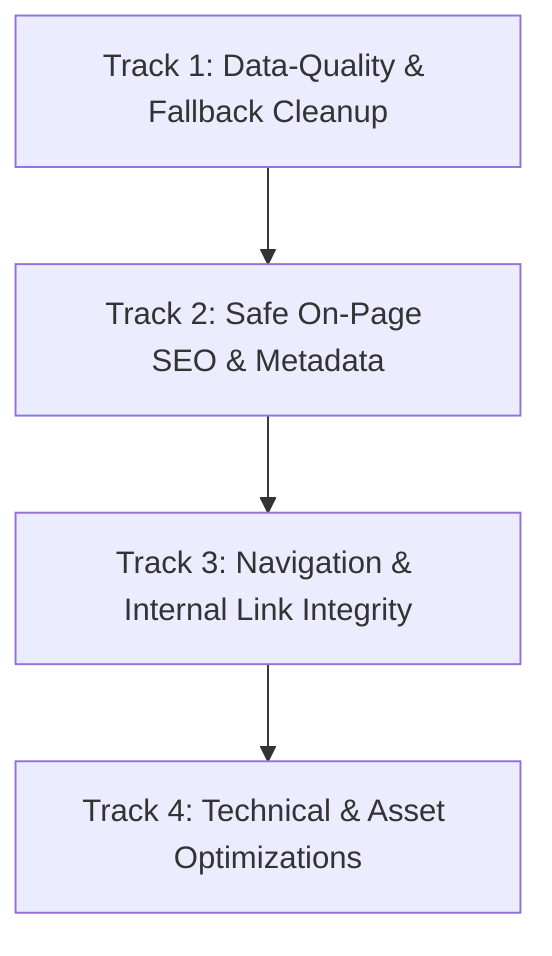

# On-Page SEO Audit, Data-Quality Remediation & Implementation Plan
**Project:** Shree Ananta Travels  
**Website URL:** [https://shreeanantatravels.com/](https://shreeanantatravels.com/)  
**Framework:** Next.js 16.3.4 (App Router) with React 19 & Tailwind CSS  
**Target Search Market:** India Domestic & International Travel, Kailash Mansarovar & Spiritual Yatras  
**Verified Business Base:** Delhi, India (`E91, East of Kailash, Delhi 110065`)  
**Date:** October 2026  
**Document Status:** Final Proposed Strategy — Pending User Authorization (No Source Code or Database Modified)

---

## 1. Executive Summary

This plan provides an objective, code-verified audit and implementation roadmap for **Shree Ananta Travels**. It addresses on-page SEO gaps, eliminates live dummy data fallbacks, establishes safe dashboard validation, and outlines clean search engine optimization within the site's existing architecture.

### 1.1 Guiding Principles
1. **Hypothesis-Driven Approach:** All target search terms, audience classifications, and seasonal priority windows are treated as **hypotheses** pending search volume data and final business validation.
2. **Zero False Guarantees:** We provide **no promises of guaranteed search rankings, star ratings, or FAQ rich snippets**. Structured data (JSON-LD) assists search engines in understanding verified content, but search display decisions are made solely by Google's algorithms. Sitelinks Search Box has been removed from all recommendations as the feature was officially retired by Google.
3. **Strict Truth in Public Data (Zero Fabricated Content or Unverified Availability Claims):** Unverified claims (such as "24/7 support", "verified stays", "verified hotel bookings", "100% verified", "Best Price Guarantee", unconfirmed refund policies, or hardcoded `InStock` availability in package structured data) are strictly prohibited. In package structured data, `availability` will be omitted unless backed by verified real-time database records. Similarly, stock images will never be presented as authentic package photos, and mock leads will never be displayed as real customer inquiries.
4. **Verified Business Location (Delhi Single Source of Truth):** Shree Ananta Travels is based in **Delhi, India**. The official business address is already saved in the dashboard/database as **E91, East of Kailash, Delhi 110065**. All legacy hardcoded code fallbacks referencing Shimla (derived from sample template code in `Footer.tsx`) are discarded. The saved database record serves as the single source of truth. Local SEO elements target Delhi only where genuinely relevant to customer search intent (e.g. Contact page and Organization schema), without stuffing "Delhi" into unrelated destination pages.
5. **Editorial Guidelines vs. Search Requirements:** Character counts for titles (typically ~50–60 characters) and descriptions (typically ~140–160 characters) are treated as **editorial guidelines to minimize truncation in search snippets**, not algorithmic requirements.
6. **Architectural Stability & Backward Compatibility:** All proposed improvements work strictly **within the existing Next.js App Router and MongoDB architecture**. We avoid unnecessary component rewrites, preserve existing valid database records, and ensure contact validation updates do not interfere with unrelated dashboard features.
7. **Active Route Disabling (Not Just Noindex):** The `/theme/[id]` route, which currently displays fictitious packages to visitors, will be disabled (returning a clean 404 Not Found) rather than relying on a `noindex` tag alone.

---

## 2. Verified Audit Findings & Corrections on Initial Review

### 2.1 Confirmed Technical & On-Page Issues
The forensic codebase inspection confirmed 17 critical observations from your initial review:
- **Sitewide Metadata Duplication:** Except for the Homepage (`/`) and Kailash landing page (`/landing/kailash-mansarovar`), all subpages (`/about`, `/services`, `/domestic`, `/international`, `/destinations`, `/packages`, `/package/[id]`, `/privacy-policy`, `/terms-and-conditions`) lack page-level metadata, falling back to the root layout string: `"Shree Ananta Travels"` and the generic description.
- **Broken `/blogs` Menu Link:** `Navbar.tsx` (line 38) links to `/blogs`, which has no route in `app/(website)` and displays a 404 error (`NotFoundPage.tsx`).
- **FAQ Content Inaccessible to Crawlers:** `FAQ.tsx` conditionally renders accordion answers only when `openIndex === index`. Collapsed answers are absent from initial server-rendered HTML.
- **Duplicate Boilerplate on Services:** `Services.tsx` repeats `"Trusted & Verified Providers"` and `"24/7 Dedicated Support"` across all 14 services.
- **Homepage Crawlability Gap:** "Popular Places" in `HeroSection.tsx` are interactive `<button>` tags with `router.push()` rather than standard crawlable `<Link>` tags.
- **Missing Internal Links:** `Footer.tsx` completely omits links to `/domestic`, `/international`, and `/landing/kailash-mansarovar`.
- **Package Detail Link Traps:** On `/package/[id]`, the "Back to Tour Packages" button routes to the root homepage (`/`) instead of `/packages`, and no breadcrumb trail exists.
- **Broken WhatsApp Link on 404:** `NotFoundPage.tsx` (line 110) contains `href="https://wa.me/?text=..."` without a phone number.
- **Textual Inconsistencies:** Typo `"Helllo"` in `MansarovarLanding.tsx` (L64 & L120) and grammatical error *"Are travel insurance included"* in `FAQ.tsx`.

### 2.2 Corrections to the Original Report
1. **Spreadsheet Row-Shift Alignment:**
   - The initial spreadsheet assigned heading `"Explore All Destinations"` and proposed heading `"Holiday Destinations in India and Abroad"` to the Rajasthan page, and labeled `/destinations` as *"Page does not exist yet"* with a proposed heading of `"Contact Us"`.
   - **Correction:** `/destinations` already exists in code (`DestinationsPage.tsx`) with heading `"Explore All Destinations"`, acting as the global destination index. Rajasthan is a dynamic route (`/domestic/[dest]`) requiring Rajasthan-specific targeting. `"Contact Us"` belongs to the `/contact` page.
2. **Services Page Keyword Cannibalization:**
   - The initial report suggested `customized tour packages` for `/services`.
   - **Correction:** Because the Homepage (`/`) and Packages page (`/packages`) already target tour package booking terms, assigning the identical term to `/services` creates keyword cannibalization. `/services` must target travel consultancy, visa assistance, flights, and logistics.
3. **Dynamic Template Reality vs. One-off Hardcoded Pages:**
   - Rather than creating static pages for every city or region, Next.js handles domestic and international destinations dynamically via `/domestic/[dest]` and `/international/[dest]`. Server-side `generateMetadata` handlers must be implemented so all destinations inherit optimized metadata automatically without refactoring client components.
4. **XML Sitemap Classification:**
   - `robots.ts` declares `sitemap: https://shreeanantatravels.com/sitemap.xml`, but no `app/sitemap.ts` or static `public/sitemap.xml` exists.
   - **Reality:** While missing, this is a technical SEO enhancement rather than an immediate indexing blocker, as Googlebot can discover linked pages through crawlable internal links once navigation is repaired.
5. **Geographic Base Correction (Delhi Headquarters vs. Legacy Shimla Fallback):**
   - The initial SEO audit report assumed the company was based in Shimla.
   - **Code & Database Investigation:** Forensic codebase inspection traced this error to legacy starter template fallback code in `src/website/app/components/Footer.tsx` (line 19): `siteConfig?.address || '2nd floor Varun Villa, UCO Bank Building, Dhalli Shimla -12, 171012'`.
   - Direct verification of the live MongoDB `siteconfigs` collection confirms the authentic registered business address is already entered and active: **`E91, East of Kailash, Delhi 110065`**.
   - **Correction:** All proposed SEO titles, meta descriptions, target keywords, headings, Contact page recommendations, and JSON-LD schemas have been thoroughly scrubbed of any Shimla references implying company headquarters. The verified database address in Delhi serves as the single source of truth.

---

## 3. Comprehensive Inventory of Dummy Data, Hardcoded Fallbacks & Sample Content

A thorough inspection of all public pages, components, dashboard forms, API routes, and database models was conducted. The following inventory lists all hardcoded fallbacks and sample production content across the repository.

### 3.1 Inventory Table

| Component / File | Field / Claim Identified | Current Hardcoded / Fallback Code | Reality in Database & Severity |
| :--- | :--- | :--- | :--- |
| `src/website/app/components/Topbar.tsx` (L9) | Business Phone Number | `const phone = siteConfig?.contactPhone \|\| agent?.phone \|\| '+91 98765 43210';` | **Critical:** Displays fake phone number when unconfigured or loading. |
| `src/website/app/components/Footer.tsx` (L17) | Business Phone Number | `const phone = siteConfig?.contactPhone \|\| agent?.whatsapp \|\| '+91 98765 43210';` | **Critical:** Displays fake phone number in footer sitewide. |
| `src/website/app/components/WhyTrustUs.tsx` (L11) | Helpline Phone Number | `const phone = siteConfig?.contactPhone \|\| agent?.whatsapp \|\| '+91 98765 43210';` | **Critical:** Triggers `tel:+919876543210` on click. |
| `src/website/app/pages/PackageDetail.tsx` (L316) | Support Phone Number | `siteConfig?.contactPhone \|\| agent?.whatsapp \|\| "+91 98765 43210";` | **Critical:** Displays fake number on all individual package pages. |
| `src/website/app/pages/PackageDetail.tsx` (L252) | WhatsApp Share / Ask Fallback | `const phone = agent?.whatsapp \|\| siteConfig?.contactPhone \|\| "911234567890";` | **Critical:** Triggers WhatsApp chat to fake number `911234567890`. |
| `src/website/app/components/Footer.tsx` (L18) | Contact Email Address | `siteConfig?.contactEmail \|\| 'info@shreeanantatravels.com';` | **Medium:** Hardcoded fallback email; DB already holds `shreeanantatravels@gmail.com`. |
| `src/website/app/components/Footer.tsx` (L19) | Office Address | `siteConfig?.address \|\| '2nd floor Varun Villa, UCO Bank Building, Dhalli Shimla -12, 171012';` | **High:** Erroneous template fallback to Dhalli Shimla; DB already holds official address: `E91, East of Kailash, Delhi 110065`. |
| `src/website/app/components/Topbar.tsx` (L10) | Support Email Address | `siteConfig?.contactEmail \|\| agent?.email \|\| 'info@shreeanantatravels.com';` | **Medium:** Hardcoded fallback email. |
| `src/website/app/pages/NotFoundPage.tsx` (L110) | WhatsApp Contact Support | `href="https://wa.me/?text=Hi%20Shree%20Ananta%20Travels..."` | **High:** Broken link missing telephone number. |
| `src/website/app/components/ChatbotButton.tsx` (L22) | Floating WhatsApp Button | `whatsappNumber = digits.startsWith('91') ? digits : '91' + digits;` | **High:** If number is empty, resolves to `https://wa.me/91` (invalid contact). |
| `src/website/app/pages/MansarovarLanding.tsx` (L41, 79) | Landing WhatsApp & Call | Resolves to `https://wa.me/91` and `tel:+91` if unconfigured. | **High:** Produces broken contact actions. |
| `src/website/app/components/Testimonials.tsx` (L15-41, 75) | Customer Reviews & Ratings | `defaultTestimonials` array: 5 static dummy reviews (Priya Sharma, Rahul & Ananya, Vikram Malhotra, Sneha Patel, Arjun Kapoor). | **High:** Displays fake customer reviews when database has no records. |
| `src/website/app/components/WhyTrustUs.tsx` (L116-132) | Trust Statistics | `15,000+ Happy Travellers`, `12+ Years Trust`, `500+ Hotel Partners`, `24/7 On-Trip Assistance`. | **High:** Unverified business statistics and claims published as factual trust badges. |
| `src/website/app/components/WhyTrustUs.tsx` (L18-35) | Service Claims & Guarantees | `"100% verified and secure"`, `"Best Price Guarantee: guaranteed lowest package rates"`, `"200+ worldwide destinations"`. | **High:** Unsubstantiated claims and price guarantees. |
| `src/website/app/components/FAQ.tsx` (L19-21) | Refund & Cancellation Policy | `"cancellations made 30+ days before departure receive 80% refund, 15-30 days receive 50%..."` | **High:** Legally sensitive refund policy presented without business validation. |
| `src/website/app/components/FAQ.tsx` (L27-29) | Travel Insurance Claim | `"Basic travel insurance is included in all international packages."` | **High:** Unconfirmed claim regarding insurance inclusions. |
| `src/website/app/pages/PackageDetail.tsx` (L127-128) | Package Ratings & Reviews | `rating: 4.9`, `reviews: 142` hardcoded for all packages. | **Critical:** Displays fake star ratings and review counts on every tour. |
| `src/website/app/pages/PackageDetail.tsx` (L130-175) | Package Fallback Itinerary & Inclusions | Hardcodes fallback 4-day itinerary, fallback inclusions, and fallback exclusions when package records lack them. | **High:** Misleads customers with invented itineraries on incomplete packages. |
| `src/website/app/pages/PackageDetail.tsx` (L39-44) | Package Fallback Gallery | `DEFAULT_IMAGES` array of 4 stock Unsplash photos used when package has no images. | **Medium:** Displays stock photos on real packages. |
| `src/website/app/pages/ThemeDetail.tsx` (L43-120) | Mock Travel Packages | Hardcoded array of packages with IDs `1` to `5`, fake prices (`₹89,999`, `₹14,999`), and fake reviews. | **Critical:** Public route displaying completely fictitious packages and pricing. |
| `src/dashboard/app/pages/BrandingSettings.tsx` (L505, 533) | Dashboard Form Placeholders | `placeholder="+91 98765 43210"`, `placeholder="123 Travel Street, Mumbai..."`. | **Medium:** Outdated placeholders during administrative setup. |
| `src/dashboard/app/pages/Profile.tsx` (L167) | Admin Profile WhatsApp Field | `placeholder="+91 98765 43210"`. | **Medium:** Outdated placeholder. |
| `src/dashboard/app/context/CRMContext.tsx` (L49) | CRM Demo Lead | `name: 'Rahul Sharma (Demo)', phone: '+91 98765 43210'`. | **Low:** Internal CRM mock lead. |

---

## 4. Remediation Plan: Zero-Dummy-Fallback Architecture & Verified Data Source

### 4.1 Single Source of Truth: Verified Dashboard & Database Data
Forensic inspection of the live MongoDB database (`siteconfigs` collection) confirms that the official business information is **already entered, verified, and accessible**:
- **Company Name:** `Shree Ananta Travels`
- **Official Address:** `E91, East of Kailash, Delhi 110065`
- **Contact Phone:** `7289037447`
- **Contact Email:** `shreeanantatravels@gmail.com`
- **Instagram:** `https://instagram.com/shreeanantatravels`

**Verification & Source of Truth Status:**
1. **Database Record Confirmed:** The active `siteconfigs` document (ID `6aa7d7d960f5f64d41761c13`) holds the exact string `"E91, East of Kailash, Delhi 110065"`.
2. **Dashboard Synchronization:** In the administrative dashboard (`src/dashboard/app/pages/BrandingSettings.tsx`, line 527), the "Office Address" input field maps directly to this database record.
3. **No User Action Required:** The address is already properly configured in the database and dashboard. There is zero conflict and no need for the user to re-enter address information.
4. **Elimination of Template Fallbacks:** The erroneous reference to Dhalli Shimla was isolated entirely to a fallback default in `src/website/app/components/Footer.tsx` (L19). All components will read strictly from `siteConfig.address`. If unconfigured, components will gracefully suppress the field rather than outputting legacy sample strings (`Dhalli Shimla`, `info@shreeanantatravels.com`, `+91 98765 43210`, `911234567890`).

### 4.2 Backward-Compatible Contact Validation & Server-Side Security (Safe, Isolated Implementation)
1. **Preserve Existing Architecture & Dependencies:**
   - In the existing codebase, phone numbers are read via `siteConfig?.contactPhone || agent?.whatsapp` or `agent?.phone`.
   - We will **not perform breaking database schema consolidations**. Existing records in `SiteConfig` and `AdminUser` will remain fully valid and backward-compatible.
2. **Isolated Client-Side Form Validation:**
   - In `BrandingSettings.tsx`, validation on `contactPhone` will be enforced only when submitting the Company Profile/Contact tab. This validation is strictly isolated so it does **not block unrelated dashboard tabs** (e.g. Hero banners, Nav links, Topbar offers, Destinations).
   - In `Profile.tsx`, the `whatsapp` field will be validated client-side for proper telephone format (`^\+?[1-9]\d{9,14}$`).
3. **Robust Server-Side API Validation:**
   - **Profile API (`app/api/auth/profile/route.ts`):** In the PUT handler, if `body.whatsapp` is supplied and non-empty, enforce regex validation (`^\+?[1-9]\d{9,14}$`). Reject invalid formats with HTTP 400 (`{ success: false, message: 'Please provide a valid WhatsApp number (10 to 15 digits)' }`). If `whatsapp` is explicitly empty, allow clearing.
   - **Site Config API (`app/api/site-config/route.ts`):** In the PUT handler, validate `body.contactPhone` only when it is present in the request payload. Enforce telephone format (`^\+?[1-9]\d{9,14}$`) while allowing partial configuration updates (hero images, navigation items, topbar offers, destination lists) without triggering telephone validation errors.

### 4.3 Safe Handling When Required Data Is Missing (Zero Dummy Display)
If a contact number is unconfigured in the dashboard:
- **Zero Dummy Display:** The fallbacks `+91 98765 43210` and `911234567890` will be completely deleted from all public components.
- **Graceful Public Suppression:**
  - In `Topbar.tsx` and `Footer.tsx`: If phone is empty, the phone link is not rendered.
  - In `ChatbotButton.tsx` and `MansarovarLanding.tsx`: If WhatsApp is unconfigured, the button will not generate invalid links like `wa.me/91` or `tel:+91`. It will either be safely suppressed or trigger an on-page inquiry form modal.
  - In `Footer.tsx`: If address or email is empty, the respective lines are not rendered.
- **Admin Dashboard Alert:** An informational alert in the admin dashboard will notify administrators:  
  *ℹ️ Operational Note: Contact phone and WhatsApp are currently unconfigured. Public contact buttons are hidden until numbers are saved.*

### 4.4 Route Disabling for `/theme/[id]` (Active 404 Behavior)
- Fictitious packages in `ThemeDetail.tsx` (`id: '1'`, `id: '2'`, etc.) must not be visible to any visitors.
- Rather than relying on a `noindex` tag alone:
  - In `app/(website)/theme/[id]/page.tsx`, we will invoke Next.js `notFound()` to **return an official 404 Not Found response**, or issue an HTTP 307 temporary redirect to `/packages`.
  - In `TravelThemes.tsx`, theme links pointing to `/theme/[id]` will be updated to point to real category searches (e.g., `/packages?search=beach`) or disabled until real database records are connected.

### 4.5 Removal of Unverified Claims Across the Codebase
1. **Public Testimonials (`Testimonials.tsx`):**
   - The `defaultTestimonials` mock array will be completely deleted.
   - If `apiTestimonials` contains zero approved records, the entire `<Testimonials />` component will render `null` (hidden from the page).
2. **Marketing Claims & Counters (`WhyTrustUs.tsx`):**
   - Remove hardcoded counter claims: `15,000+ Happy Travellers`, `12+ Years Trust`, `500+ Hotel Partners`.
   - Remove unverified claims: `"100% verified and secure"`, `"Best Price Guarantee"`, `"24/7 On-Trip Assistance"`.
   - Replace with honest, service-oriented descriptions: *"Customized Itineraries"*, *"Direct Inquiry Assistance"*, *"Curated Accommodations"*, *"Transparent Pricing"*.
3. **FAQ Policies (`FAQ.tsx`):**
   - Remove the unverified `"80% refund"` and `"insurance included in all international packages"` defaults.
   - Replace with neutral informational text: *"Cancellation terms depend on airline and hotel provider policies. Exact terms are provided with your personalized itinerary quotation."*
4. **Package Details (`PackageDetail.tsx`):**
   - Remove hardcoded `rating: 4.9` and `reviews: 142`.
   - Remove hardcoded 4-day fallback itineraries and inclusion/exclusion boilerplate. When a package has no itinerary entered, display: *"Detailed day-by-day itinerary available on request. Contact our travel specialist."*
5. **Default Stock-Image Gallery (`PackageDetail.tsx` - Lines 39-44 & 107):**
   - The `DEFAULT_IMAGES` array containing 4 stock Unsplash photos of tropical beaches will be completely deleted.
   - **Remediation Logic:** If a package has authentic uploaded photos (`rawImages = [pkg.imageUrl1, pkg.imageUrl2, pkg.imageUrl3, pkg.imageUrl4].filter(Boolean)`), render only those genuine photos in the viewer. If a package lacks uploaded photos (`rawImages.length === 0`), do **not** present stock photos as actual tour images. Instead, display an honest, branded destination placeholder card (*"Authentic photos & detailed itinerary guide available upon request"*), and suppress the thumbnail gallery grid.
6. **CRM Demo Lead (`CRMContext.tsx` - Lines 46-56 & 116-119):**
   - The `initialMockLeads` mock lead (`Rahul Sharma (Demo)`, `+91 98765 43210`) will be completely deleted.
   - **Remediation Logic:** Initialize `leadsData` state as an empty array `[]`. When the API returns zero leads (`leadsResponse.data.length === 0`), maintain `leadsData` as `[]` and render a professional empty state UI in the CRM leads view (*"No customer inquiries received yet. Inquiries submitted via website contact and booking forms will appear here in real-time."*). Under no circumstances will demo leads or dummy contact numbers be displayed as real customer inquiries, while all genuine database records fetched from `/api/leads` are strictly preserved.

---

## 5. Strategic SEO Blueprint: Hypotheses, Priorities & Phasing

*Note: All search terms, audience targets, and seasonal priorities are working hypotheses subject to keyword research and final business owner sign-off.*

### 5.1 Strategic Priority Clusters (Hypotheses)

```
┌─────────────────────────────────────────────────────────────────────────────┐
│                       STRATEGIC PRIORITY CLUSTERS                           │
├─────────────────────────────────────────────────────────────────────────────┤
│ CLUSTER 1: Kailash Mansarovar & Himalayan Spiritual (Nepal / Muktinath)     │
│ CLUSTER 2: Rajasthan Heritage Circuit (Jaipur, Udaipur, Jodhpur, Jaisalmer) │
│ CLUSTER 3: Customized Tour Packages (Any Destination on Demand)             │
│ CLUSTER 4: Seasonal Winter Destinations (Kerala, Kashi, Agra, Snow, Intl)  │
└─────────────────────────────────────────────────────────────────────────────┘
```

#### Cluster 1: Kailash Mansarovar & Nepal (Muktinath) Yatra
- **Target Audience:** Indian devotees, NRI/international pilgrims, family elders.
- **Working Keywords:** `kailash mansarovar yatra packages`, `kailash mansarovar yatra 2026 2027`, `kailash yatra by road`, `kailash yatra by helicopter`, `nepal muktinath yatra`.
- **Target URL:** `/landing/kailash-mansarovar` (Dedicated high-conversion landing page).
- **Action Items:**
  - Link `/landing/kailash-mansarovar` directly from `Navbar.tsx` (currently points to `/packages?category=kailash`) and `Footer.tsx`.
  - Fix `"Helllo"` typo in WhatsApp trigger.
  - Implement `TouristTrip` structured data pulling strictly confirmed package parameters.
  - **Service Verification Check:** Forensic inspection of MongoDB Kailash packages confirmed that **Yatra permits, visa documentation assistance, and Nepali/Tibetan guide management** are verified inclusions. Conversely, **medical expenses and ambulance charges are explicitly listed under package exclusions**; metadata strictly omits claims of "medical support" in favor of verified guide assistance and Yatra permits.

#### Cluster 2: Rajasthan Heritage (November to February Window)
- **Target Audience:** Families, honeymoon couples, inbound international tourists.
- **Key Cities:** Jaipur, Udaipur, Jodhpur, Jaisalmer (desert camping), Pushkar.
- **Working Keywords:** `rajasthan tour packages`, `customized rajasthan family tour`, `jaipur udaipur jodhpur tour package`, `jaisalmer desert safari tour package`.
- **Target URL:** Dynamic route `/domestic/rajasthan`.
- **Action Items:** Implement dynamic metadata generation; ensure packages with `location: "Rajasthan"` or Rajasthan cities resolve cleanly.

#### Cluster 3: "Customized Tour Packages" (Bespoke Travel on Demand)
- **Target Audience:** Travellers seeking tailor-made plans rather than fixed group schedules.
- **Working Keywords:** `customized tour packages`, `tailored travel itineraries india`, `custom holiday packages for families`.
- **Target URLs:** Homepage (`/`) and Packages hub (`/packages`).

#### Cluster 4: Seasonal Winter Domestic & International Circuits
- **South India & Kerala:** `/domestic/kerala` (Alleppey houseboats, Munnar, temple trails).
- **Kashi (Varanasi):** `/domestic/varanasi` (Kashi Vishwanath, Ganga Aarti).
- **Agra & Golden Triangle:** `/domestic/agra` (Inbound international tourists).
- **Snow Getaways:** `/domestic/manali`, `/domestic/chopta`, `/domestic/nainital`.
- **International:** `/international/bali`, `/international/vietnam`, `/international/singapore`, `/international/sri-lanka`, `/international/nepal`.

### 5.2 Local SEO Strategy & Geographic Intent Calibration (Targeting Delhi Only Where Relevant)

To maximize local conversion in Delhi NCR while preserving national and international rankings, the SEO plan applies strict geographic search intent calibration:

1. **Where Delhi Local SEO Is Applied (High-Relevance Entity & Departure Intent):**
   - **Contact Us Page (`/contact`):** Explicitly highlights the verified Delhi office in East of Kailash, phone lines, and local concierge inquiry channels.
   - **About Us Page (`/about`):** Accurately presents Shree Ananta Travels as a Delhi-based tour planning and pilgrimage agency, establishing legitimate geographical entity signals.
   - **Structured Data (`TravelAgency` JSON-LD):** Accurately links the entity's physical headquarters (`streetAddress: "E91, East of Kailash"`, `addressLocality: "New Delhi"`, `postalCode: "110065"`, `addressCountry: "IN"`).
   - **Sitewide Footer (`Footer.tsx`):** Renders the verified Delhi address dynamically fetched from `SiteConfig.address`.
   - **Google Business Profile (GBP) & Local Citations:** Aligns exact NAP (Name, Address, Phone) with the verified dashboard entry.
   - **Departure-Specific Intent (Contextual Body Content Only):** Where travellers explicitly search for departures from the capital (e.g., *"Kailash Mansarovar Yatra from Delhi"*, *"Rajasthan tour packages from Delhi"*), body content on relevant package pages may naturally reference Delhi departures without altering the global page title or URL structure.

2. **Where Delhi Is Strictly Excluded (Preventing Geographic Stuffing & Audience Dilution):**
   - **Destination Hub Pages (`/domestic`, `/international`, `/destinations`):** Must maintain broad appeal for travellers across all of India and international diaspora. Forcing "Delhi" into titles like `India Tour Packages` or `Holiday Destinations` would artificially limit search impressions from other major travel hubs (Mumbai, Bengaluru, Ahmedabad, etc.).
   - **Dynamic Destination Pages (`/domestic/[dest]`, `/international/[dest]`):** Pages for Rajasthan, Kerala, Kashmir, Manali, Bali, Vietnam, etc., target queries for the destinations themselves (e.g. `Rajasthan Tour Packages | Shree Ananta Travels`). Adding "Delhi" (e.g., `Rajasthan Tour Packages in Delhi`) creates semantic confusion, misrepresents the location of the trip, and harms organic click-through rates.
   - **Dynamic Package Detail Pages (`/package/[id]`):** Titled strictly by the specific package name and duration (e.g., `{Package Title} ({Duration}) | Shree Ananta Travels`), keeping metadata tightly focused on the tour experience itself.

---

## 6. Page-Wise Proposed Metadata & Heading Specifications

*Editorial Guideline: Titles are drafted between ~50–60 characters; descriptions between ~140–160 characters to optimize readability and prevent truncation in standard search result snippets. All unverified claims (such as "24/7 support" and "verified stays") and erroneous geographic tags (Shimla) have been removed. Delhi local targeting is used only where genuinely relevant to the business entity (About, Contact, Schema).*

### 6.1 Homepage (`/`)
- **Working Keywords:** `customized tour packages`, `tour packages for india and abroad`, `shree ananta travels`
- **Proposed Title:** `Customized Tour Packages for India & Abroad | Shree Ananta` *(57 chars)*
- **Proposed Meta Description:** `Plan customized tour packages across India and abroad with Shree Ananta Travels. Handcrafted family holidays, couple getaways, and spiritual yatras.` *(149 chars)*
- **Proposed H1:** `Tour Packages for India and Abroad: Customized Holiday Itineraries`
- **Internal Linking:** Convert `HeroSection.tsx` popular destination buttons into crawlable `<Link>` tags pointing to `/domestic/rajasthan`, `/domestic/kerala`, `/domestic/kashmir`, `/landing/kailash-mansarovar`, `/international/bali`, and `/international/vietnam`.
- **Schema:** `TravelAgency` (populated strictly from verified database fields: Delhi address, company name, phone, email).

### 6.2 About Us (`/about`)
- **Working Keywords:** `about shree ananta travels`, `tour and yatra planners delhi`, `travel agency delhi`
- **Proposed Title:** `About Shree Ananta Travels | Tour & Yatra Planners` *(51 chars)*
- **Proposed Meta Description:** `Meet Shree Ananta Travels: tour and spiritual yatra planners based in Delhi. We organize authentic travel, permits, hotel stays, and transportation.` *(150 chars)*
- **Proposed H1:** `About Shree Ananta Travels: Tour and Yatra Planners`
- **Sub-heading (H2):** `Because Every Journey Is More Than an Itinerary`
- **Image Alt Tags:** Replace generic alts (`"Travel"`, `"Adventure"`, `"Views"`, `"Beach"`) with factual descriptions reflecting travel planning services.

### 6.3 Services (`/services`)
- **Working Keywords:** `travel services`, `tour planning consultancy`, `flight hotel visa booking`
- **Proposed Title:** `Travel Services & Tour Planning | Shree Ananta Travels` *(53 chars)*
- **Proposed Meta Description:** `Comprehensive travel services: custom holiday planning, spiritual yatra permits, flight reservations, hotel bookings, and corporate travel support.` *(147 chars)*
- **Proposed H1:** `Comprehensive Travel Services & Tour Planning`
- **Content Fix:** Replace repetitive boilerplate with distinct, accurate descriptions for each of the 14 service categories.

### 6.4 Kailash Mansarovar Landing (`/landing/kailash-mansarovar`)
- **Working Keywords:** `kailash mansarovar yatra packages`, `kailash yatra 2026 2027`
- **Proposed Title:** `Kailash Mansarovar Yatra Packages | Shree Ananta Travels` *(55 chars)*
- **Proposed Meta Description:** `Plan your sacred Kailash Mansarovar Yatra with Shree Ananta Travels. Air and helicopter packages with visa guidance, Yatra permits, and experienced tour guides.` *(158 chars)*
- **Proposed H1:** `Kailash Mansarovar Yatra Packages`
- **Service Verification Note:** Forensic inspection of MongoDB Kailash packages confirmed that **Yatra permits, visa documentation assistance, and Nepali/Tibetan guide management** are verified inclusions. Conversely, **medical expenses, ambulance charges, and evacuation are explicitly listed under package exclusions**. Therefore, "medical support" has been strictly removed from metadata, keeping claims 100% verified and truthful.

### 6.5 Domestic Destinations Hub (`/domestic`)
- **Working Keywords:** `india tour packages`, `domestic holiday packages`
- **Proposed Title:** `India Tour Packages: Handcrafted Holidays | Shree Ananta` *(56 chars)*
- **Proposed Meta Description:** `Explore Incredible India with customized domestic tour packages. Handcrafted holiday itineraries for Rajasthan, Kerala, Kashi, Kashmir, and mountain breaks.` *(157 chars)*
- **Proposed H1:** `India Tour Packages & Domestic Holiday Destinations`

### 6.6 International Destinations Hub (`/international`)
- **Working Keywords:** `international tour packages from india`, `world holiday packages`
- **Proposed Title:** `International Tour Packages from India | Shree Ananta` *(53 chars)*
- **Proposed Meta Description:** `Curated international holiday packages from India. Travel to Bali, Vietnam, Singapore, Sri Lanka, and Nepal with visa guidance and flight bookings.` *(146 chars)*
- **Proposed H1:** `International Tour Packages from India`

### 6.7 All Destinations Directory (`/destinations`)
- **Working Keywords:** `holiday destinations`, `tour destinations india and abroad`
- **Proposed Title:** `Holiday Destinations in India & Abroad | Shree Ananta` *(53 chars)*
- **Proposed Meta Description:** `Browse all popular holiday destinations across India and worldwide. Choose your destination to explore tailored packages, hotel stays, and quick quotes.` *(158 chars)*
- **Proposed H1:** `Explore Holiday Destinations in India and Abroad`

### 6.8 Tour Packages Catalog (`/packages`)
- **Working Keywords:** `curated tour packages`, `holiday packages booking`
- **Proposed Title:** `Curated Tour Packages: India & Abroad | Shree Ananta` *(51 chars)*
- **Proposed Meta Description:** `Browse all tour packages curated by Shree Ananta Travels. Compare itineraries for Kailash Mansarovar, Rajasthan, Kerala, Bali, Vietnam, and custom family trips.` *(160 chars)*
- **Proposed H1:** `Curated Tour Packages: Domestic, International & Yatras`

### 6.9 Dynamic Destination Engine (`/domestic/[dest]` & `/international/[dest]`)
- **Dynamic Title Formula:**  
  Domestic: `{Destination} Tour Packages | Shree Ananta Travels`  
  International: `{Destination} Tour Packages from India | Shree Ananta`
- **Dynamic Meta Description Formula:**  
  `Customized {Destination} tour packages with hotel stays and private transfers. Plan your custom {Destination} holiday itinerary today.` *(<160 chars)*
- **Dynamic H1:** `{Destination} Tour Packages`
- **Technical Implementation:** Server-side `generateMetadata({ params })` fetching destination parameters and verifying against database records.

### 6.10 Dynamic Package Detail Engine (`/package/[id]`)
- **Dynamic Title Formula:**  
  `{Package Title} ({Duration}) | Shree Ananta Travels` *(<60 chars)*
- **Dynamic Meta Description Formula:**  
  `Book the {Package Title} covering {Location} for {Duration}. Includes stay, meals, transfers, and sightseeing. Request a custom quote today.` *(<160 chars)*
- **Dynamic H1:** `{Package Title}`
- **Technical Implementation:** Server-side `generateMetadata({ params })` fetching the package document directly by ID.
- **Link Fix:** Fix line 335 in `PackageDetail.tsx`: change `"Back to Tour Packages"` link from `/` to `/packages`.

### 6.11 Contact Page (`/contact`)
- **Source of Truth:** Reads verified address (`E91, East of Kailash, Delhi 110065`), phone (`7289037447`), and email (`shreeanantatravels@gmail.com`) directly from MongoDB `SiteConfig`.
- **Database Status:** Verified active in `siteconfigs` collection (ID `6aa7d7d960f5f64d41761c13`). No re-entry required.
- **Proposed Title:** `Contact Shree Ananta Travels | Delhi Office & Inquiries` *(55 chars)*
- **Proposed Meta Description:** `Contact Shree Ananta Travels at our Delhi office in East of Kailash. Inquire about customized holiday packages, Kailash Yatra bookings, and travel planning.` *(158 chars)*
- **Proposed H1:** `Contact Shree Ananta Travels: Delhi Office & Concierge Desk`
- **Page Elements:** Confirmed NAP, interactive Google Map embed centered on East of Kailash, Delhi (Pincode: 110065), direct inquiry form, telephone and WhatsApp links.

---

## 7. Structured Data Blueprint (Verified Delhi Business Data)

JSON-LD structured data will be implemented using a dedicated helper that outputs **strictly verified data** dynamically from the database (`SiteConfig` and `Package` models), ensuring that any future administrative dashboard updates reflect immediately in Google's schema graph without code changes.

### 7.1 `TravelAgency` Schema (Homepage & Sitewide Layout)
```json
{
  "@context": "https://schema.org",
  "@type": "TravelAgency",
  "@id": "https://shreeanantatravels.com/#organization",
  "name": "Shree Ananta Travels",
  "url": "https://shreeanantatravels.com",
  "description": "Customized domestic and international tour packages, sacred Kailash Mansarovar yatras, and travel planning services.",
  "telephone": "+91-7289037447",
  "email": "shreeanantatravels@gmail.com",
  "address": {
    "@type": "PostalAddress",
    "streetAddress": "E91, East of Kailash",
    "addressLocality": "New Delhi",
    "addressRegion": "Delhi",
    "postalCode": "110065",
    "addressCountry": "IN"
  }
}
```

### 7.2 `ContactPage` Schema (Contact Page)
```json
{
  "@context": "https://schema.org",
  "@type": "ContactPage",
  "name": "Contact Shree Ananta Travels",
  "url": "https://shreeanantatravels.com/contact",
  "description": "Get in touch with Shree Ananta Travels at our East of Kailash office in Delhi.",
  "mainEntity": {
    "@id": "https://shreeanantatravels.com/#organization"
  }
}
```
*Note: Fields for `geo` coordinates and `openingHoursSpecification` will be appended dynamically only when confirmed and populated in the dashboard.*

### 7.3 `BreadcrumbList` Schema
```json
{
  "@context": "https://schema.org",
  "@type": "BreadcrumbList",
  "itemListElement": [
    {
      "@type": "ListItem",
      "position": 1,
      "name": "Home",
      "item": "https://shreeanantatravels.com"
    },
    {
      "@type": "ListItem",
      "position": 2,
      "name": "Domestic Destinations",
      "item": "https://shreeanantatravels.com/domestic"
    },
    {
      "@type": "ListItem",
      "position": 3,
      "name": "Rajasthan Tour Packages",
      "item": "https://shreeanantatravels.com/domestic/rajasthan"
    }
  ]
}
```

### 7.4 `TouristTrip` / `Product` Schema (Package Detail Pages)
Populated strictly from the MongoDB package record:
```json
{
  "@context": "https://schema.org",
  "@type": "TouristTrip",
  "name": "Package Title from Database",
  "description": "Package Description from Database",
  "provider": {
    "@id": "https://shreeanantatravels.com/#organization"
  },
  "offers": {
    "@type": "Offer",
    "price": "Actual Numeric Price from DB",
    "priceCurrency": "INR",
    "url": "https://shreeanantatravels.com/package/[id]"
  }
}
```
*Note on Offer Availability:* Do **not** hardcode `"availability": "https://schema.org/InStock"`. In Next.js/MongoDB, the `Package` model tracks pricing and visibility (`isActive`), but does not maintain an automated seat/inventory booking engine. Unless actual booking availability is explicitly tracked and verified in the database, the `availability` property MUST be omitted from the schema to avoid publishing unverified availability claims to search engines.  
*Note on Reviews:* `aggregateRating` and review counts will NOT be rendered unless actual, verified review records exist in the database.

---

## 8. Prioritized Implementation Sequence

The work is organized into 4 distinct tracks to ensure safety, clarity, and architectural integrity.



### Track 1: Data-Quality Remediation & Fallback Removal (Priority: Urgent)
1. **Remove Hardcoded Fallbacks:** Eliminate all occurrences of `+91 98765 43210`, `911234567890`, and the legacy `Dhalli Shimla` fallback in `Topbar.tsx`, `Footer.tsx`, `WhyTrustUs.tsx`, and `PackageDetail.tsx`. Bind directly to verified `siteConfig` values (`Delhi 110065`, `7289037447`).
2. **Graceful Contact Degradation:** Implement safe handling so missing phone/WhatsApp numbers suppress links rather than generating broken URLs (`wa.me/91` or `tel:+91`).
3. **Remove Fake Reviews & Sample Claims:** 
   - Remove `defaultTestimonials` from `Testimonials.tsx`. Hide section when zero approved reviews exist.
   - Remove unverified counters (`15,000+`, `12+ Years`, `500+`) and claims from `WhyTrustUs.tsx`.
   - Remove `rating: 4.9`, `reviews: 142`, and fallback itineraries from `PackageDetail.tsx`.
4. **Remediate Stock Images & CRM Mock Leads:**
   - Remove `DEFAULT_IMAGES` stock Unsplash gallery from `PackageDetail.tsx`. If a package lacks uploaded photos, render an honest branded placeholder card and suppress the gallery thumbnail strip.
   - Remove `initialMockLeads` (`Rahul Sharma (Demo)`) from `CRMContext.tsx`. Initialize CRM leads state to `[]` and render a professional empty state UI when zero inquiries exist, strictly preserving genuine database leads.
5. **Disable Fictitious Route (`/theme/[id]`):** Update route to return 404 (`notFound()`) so visitors cannot access mock packages.
6. **Server & Client Contact Validation (Isolated):**
   - Add server-side validation in `app/api/auth/profile/route.ts` for `body.whatsapp` (E.164 regex: `^\+?[1-9]\d{9,14}$`).
   - Add server-side validation in `app/api/site-config/route.ts` for `body.contactPhone` when supplied.
   - Maintain strict field isolation on both client and server so updating unrelated dashboard tabs (Hero banners, Nav links, Topbar offers, Destinations) is never blocked.

### Track 2: Safe On-Page SEO & Dynamic Metadata (Priority: High)
1. **Dynamic Metadata Handlers:**
   - Add `generateMetadata()` in `app/(website)/package/[id]/page.tsx`.
   - Add `generateMetadata()` in `app/(website)/domestic/[dest]/page.tsx`.
   - Add `generateMetadata()` in `app/(website)/international/[dest]/page.tsx`.
2. **Static Page Metadata:** Add unique `metadata` exports to `/about`, `/services`, `/domestic`, `/international`, `/destinations`, `/packages`, `/privacy-policy`, and `/terms-and-conditions`.
3. **Heading Optimization:** Align H1 headings on static pages with primary service/destination themes while preserving emotional brand subheadings.
4. **Verified Schema.org Injection:** Deploy lightweight JSON-LD for `TravelAgency` (Delhi address), `TouristTrip` (omitting `availability` unless verified in DB), and `BreadcrumbList` using only verified database values.

### Track 3: Navigation & Internal Link Integrity (Priority: High)
1. **Fix Broken `/blogs` Menu Link:** Remove or temporarily disable the `/blogs` menu item until a real blog section exists.
2. **Connect Kailash Landing Page:** Link the Navbar item `"Kailash Mansarovar"` directly to `/landing/kailash-mansarovar` and add a link in `Footer.tsx`.
3. **Crawlable Destination Links:** Convert `HeroSection.tsx` "Popular Places" buttons into standard crawlable `<Link>` tags.
4. **Package Page Back Button:** Fix `PackageDetail.tsx` line 335 link so `"Back to Tour Packages"` navigates to `/packages`.
5. **Footer Completeness:** Add `/domestic` and `/international` to footer navigation.
6. **Accessible FAQ:** Update `FAQ.tsx` disclosure logic so answers exist in the server DOM.

### Track 4: Technical & Asset Optimizations (Priority: Medium - Measured Impact)
1. **Comprehensive Dynamic XML Sitemap (`app/sitemap.ts`):** 
   - Dynamically generate a valid XML sitemap including:
     - All static canonical indexable URLs (`/`, `/about`, `/services`, `/landing/kailash-mansarovar`, `/domestic`, `/international`, `/destinations`, `/packages`, `/contact`, `/privacy-policy`, `/terms-and-conditions`).
     - **ALL published, active, indexable destination URLs** from `siteconfigs.destinations` where `active === true` (both domestic and international), dynamically slugified and canonicalized—not just featured or trending ones.
     - **ALL published, active, indexable tour package URLs** from MongoDB `Package.find({ isActive: true })` with their `lastModified: pkg.updatedAt` timestamps—not just trending packages.
     - Strictly exclude inactive packages (`isActive === false`), draft records, and disabled routes (`/theme/[id]`, `/blogs`).
2. **Favicon Compression:** Compress `public/favicon.png` and `public/icon.png` from 2.69 MB down to <25 KB to improve asset load speed.
3. **Contact Page Implementation:** Create `/contact` rendering the verified Delhi address, phone, and inquiry form.

---

## 9. Affected Files, Models & APIs

| Component / Layer | Specific Files Affected | Scope of Modification |
| :--- | :--- | :--- |
| **Public Contact Components** | `Topbar.tsx`, `Footer.tsx`, `WhyTrustUs.tsx`, `NotFoundPage.tsx`, `ChatbotButton.tsx` | Remove hardcoded dummy numbers and legacy Shimla fallback; bind strictly to verified `siteConfig` (`Delhi 110065`, `7289037447`). |
| **Package Detail Experience** | `src/website/app/pages/PackageDetail.tsx` | Remove fake rating (4.9), fake review count (142), fake fallback itinerary; delete `DEFAULT_IMAGES` stock Unsplash fallback to show only authentic photos or branded placeholder; fix WhatsApp fallback (`911234567890`); fix back link to `/packages`. |
| **Social Proof & Claims** | `src/website/app/components/Testimonials.tsx`, `WhyTrustUs.tsx`, `FAQ.tsx` | Remove sample reviews; remove unverified statistics and refund/insurance claims; suppress empty review section. |
| **CRM Lead Inquiries** | `src/dashboard/app/context/CRMContext.tsx` | Delete `initialMockLeads` demo lead (`Rahul Sharma (Demo)`); initialize empty array state `[]` with clean empty-state UI; preserve genuine database leads. |
| **Route Disabling** | `app/(website)/theme/[id]/page.tsx`, `TravelThemes.tsx` | Disable route with 404 (`notFound()`) to prevent visitors from viewing fictitious mock packages. |
| **Metadata & Server Routes** | `app/(website)/package/[id]/page.tsx`, `domestic/[dest]/page.tsx`, `international/[dest]/page.tsx` | Implement `generateMetadata()` using live database parameters; await asynchronous Next.js 16 params; omit `availability` from schema. |
| **Static Route Wrappers** | `about/page.tsx`, `services/page.tsx`, `domestic/page.tsx`, `international/page.tsx`, `destinations/page.tsx`, `packages/page.tsx` | Export static `metadata` objects (Title, Description, Canonical, OG). |
| **Navigation & Links** | `Navbar.tsx`, `HeroSection.tsx`, `Footer.tsx` | Remove broken `/blogs` link; convert popular places to `<Link>` tags; link Kailash landing page. |
| **Dashboard Validation & APIs** | `BrandingSettings.tsx`, `Profile.tsx`, `app/api/auth/profile/route.ts`, `app/api/site-config/route.ts` | Add isolated client & server-side regex validation for WhatsApp and phone numbers without blocking unrelated settings tabs; update placeholders. |
| **Technical Assets** | `app/sitemap.ts` *(new)*, `public/favicon.png`, `public/icon.png` | Add dynamic XML sitemap generator covering all canonical pages, all active destinations, and all published packages; compress oversized favicon assets. |

---

## 10. Testing, Verification & Quality Assurance Checklist

- [ ] **Zero Dummy Data & Shimla Fallback Check:** Search production build HTML to verify complete absence of `98765 43210`, `911234567890`, and `Dhalli Shimla`. Verify live output displays verified Delhi address (`E91, East of Kailash, Delhi 110065`) and phone (`7289037447`).
- [ ] **Stock Image & CRM Demo Lead Check:** Verify `DEFAULT_IMAGES` is removed from `PackageDetail.tsx` and packages without images display an honest placeholder rather than generic stock beaches. Verify CRM leads list does not display `Rahul Sharma (Demo)` or dummy inquiries.
- [ ] **Unconfigured State Handling:** Verify that clearing contact fields in the dashboard gracefully suppresses phone/WhatsApp buttons without throwing errors or creating dead `tel:`/`wa.me` links.
- [ ] **Theme Route 404 Test:** Verify `/theme/beach` and `/theme/adventure` return official 404 Not Found responses and display no fake packages.
- [ ] **Dashboard Tab Isolation & Server Validation Test:** Verify submitting invalid phone format to `/api/auth/profile` and `/api/site-config` triggers 400 validation error, while updating hero images, nav links, or topbar offers succeeds without being blocked by contact field validation.
- [ ] **Metadata Output Inspection:** Confirm every public URL generates unique `<title>` and `<meta name="description">` in the initial HTML response.
- [ ] **Dynamic Route Metadata Test:** Verify `/domestic/rajasthan`, `/domestic/kashmir`, and `/package/[id]` dynamically reflect their respective destination and package titles.
- [ ] **Navigation & Link Audit:** Confirm zero 404 links across navbar, footer, and package detail back buttons.
- [ ] **Google Rich Results Validation:** Validate sample URLs against [Google Rich Results Test](https://search.google.com/test/rich-results) to confirm valid, warning-free JSON-LD containing verified Delhi Organization data and `TouristTrip` structured data without hardcoded `InStock` availability.
- [ ] **Comprehensive XML Sitemap Audit:** Validate `https://shreeanantatravels.com/sitemap.xml` returns valid XML including all core static canonical pages, all published active destinations from `siteconfigs.destinations`, and all published active packages from `packages` collection.

---

## 11. Operational Alignment & Business Confirmation Summary

The operational configuration status is verified as follows:

| Item | Verified Configuration in System | Status / Notes |
| :--- | :--- | :--- |
| **1. Primary Phone Number** | `7289037447` | Verified in MongoDB `SiteConfig`. Single source of truth. |
| **2. Primary Contact Email** | `shreeanantatravels@gmail.com` | Verified in MongoDB `SiteConfig`. Single source of truth. |
| **3. Registered Office Address** | `E91, East of Kailash, Delhi 110065` | **Verified in MongoDB `siteconfigs` collection (Active in dashboard `BrandingSettings.tsx`)**. Single source of truth. No re-entry required. Used dynamically across Footer, Contact page, and Organization Schema. Legacy Shimla template fallback eliminated. |
| **4. Operational Statistics & Claims** | `15,000+ Travellers`, `12+ Years`, `500+ Hotels`, `24/7 Support` | Removed from public display unless verified numbers are provided. |
| **5. Cancellation & Refund Policy** | FAQ states *"80% refund 30+ days prior"* | Removed; replaced with neutral provider-dependent policy wording. |
| **6. International Travel Insurance** | FAQ states *"Basic insurance included in all international packages"* | Removed; replaced with neutral informational wording. |
| **7. "Blogs" Menu Item** | Navbar links to broken `/blogs` (404 error) | Disabled/hidden from navigation menu until content is ready. |
| **8. Kailash Services (Permits, Medical, Guides)** | Yatra permits, visa assistance, and Nepali/Tibetan tour guides are verified inclusions in MongoDB. Medical expenses/ambulance are explicitly listed under package exclusions. | "Medical support" strictly removed from proposed metadata. Retained verified Yatra permits, visa guidance, and experienced tour guides. |

---

## 12. Deliverables Summary Upon Implementation

Once approved, the execution will deliver:
1. **Zero Dummy Data Live:** Complete elimination of fake phone numbers (`98765 43210`, `911234567890`), fake reviews, fake ratings, mock itineraries, default stock Unsplash image galleries in `PackageDetail.tsx`, mock CRM leads in `CRMContext.tsx`, and template Shimla fallbacks across the entire platform.
2. **Verified Delhi Business Presentation:** Consistent presentation of the official business address (`E91, East of Kailash, Delhi 110065`), official phone (`7289037447`), and official email (`shreeanantatravels@gmail.com`) across footer, Contact page, and Schema markup.
3. **Disabled Mock Route:** Official 404 handling on `/theme/[id]` ensuring visitors never see fictitious packages.
4. **Safe, Isolated Client & Server Validation:** Server-side telephone regex validation for WhatsApp in `app/api/auth/profile/route.ts` and for phone in `app/api/site-config/route.ts`, with complete dashboard tab isolation so updating unrelated settings is never blocked.
5. **100% Unique Metadata:** Unique, keyword-aligned titles and meta descriptions across all static pages and dynamic templates without rewriting client components.
6. **Verified Schema.org Structured Data:** Valid JSON-LD schemas reflecting only true database records without fabricated values, omitting `availability` from package structured data unless verified in the database.
7. **Repaired Navigation:** Zero broken links, properly linked Kailash landing page, crawlable internal links, and corrected package back-navigation.
8. **Comprehensive Dynamic XML Sitemap:** Automated `sitemap.xml` serving valid URLs for all static canonical pages, all published active destinations from `siteconfigs.destinations`, and all published active tour packages from MongoDB.

---
*End of Revised SEO & Data-Quality Implementation Plan. Awaiting explicit user authorization.*
